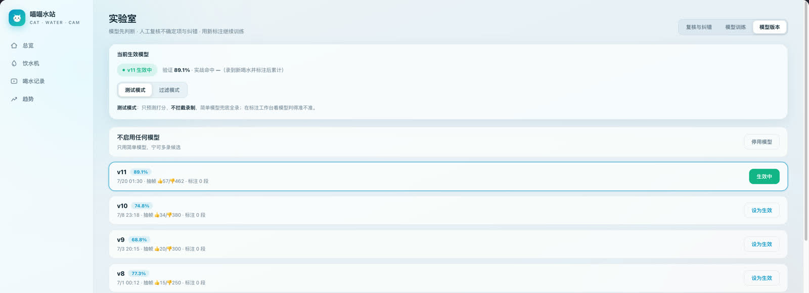
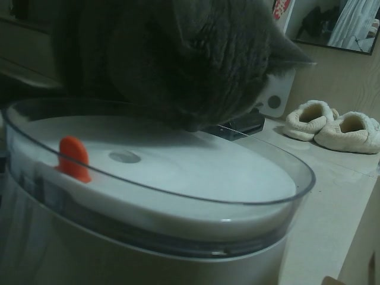

# 喵喵水站 Cat Water Cam

[](#测试)
[](https://www.python.org/)
[](LICENSE)
[](https://github.com/Tght1211/cat-water-cam/releases/latest)

为自己的小猫、饮水机和相机角度训练专属模型，并通过复核与纠错持续改善。普通 USB 摄像头加一台常开电脑，就能搭建猫咪饮水监控：全画面发生变化即录制，不依赖模型先认出猫；以 480×360、30 fps 保存连续片段，视频滚动保留最近 3 天（含训练视频副本），用本地视频模型判断是否真的喝水，在网页查看实时画面、喝水记录、趋势、饮水机状态，并通过人工纠错持续训练。



## 真实效果

下面是项目真实采集、人工确认的喝水片段，不是合成素材。点击封面可播放原始 MP4。

[](https://github.com/Tght1211/cat-water-cam/releases/download/v0.2.0/cat-drinking-demo.mp4)

> 真实录像会包含家庭环境。默认配置只在本机保存画面；决定公开自己的数据前，请先检查隐私内容。

## 能做什么

- **持续采集与流畅预览**：采集、检测、录制分线程，网页通过 MJPEG 查看实时画面。
- **画面变化即录制**：不限制水碗区域、毛色或停留时长，无冷却期；变化停止 3 秒后收尾，持续变化按 15 秒分段，含触发前回放缓冲。弱光也保留变化片段等待复核。H.264 MP4 可直接在浏览器播放。
- **按次统计喝水**：相邻已确认喝水片段的开始时间间隔不足 60 秒，合并为同一次；连续喝水超过一分钟也只计一次，直到相邻确认片段间隔达到 60 秒才记下一次。例如 10:00:00、10:00:45、10:01:20 算一次，10:02:20 再算一次。总览、喝水记录、趋势和饮水机计数共用此规则；历史数据按新规则重算，原始录像与标注保留，跨午夜不重复计数。
- **3 天滚动保存**：默认 `motion_recording=true`、`fps=30`、`retention_days=3`；每 30 秒检查过期视频，录像和训练视频副本均删除，已确认的统计与标签保留。
- **专属场景训练**：框选饮水区域，用连续动作窗口训练分类头，或进一步微调 S3D 主干末段；支持可选 VideoMAE 主干。
- **真实成长记录**：保存独立测试的漏判、误判和新旧版本在共同留出片段上的对比，表现退步时保留原模型。
- **开箱即用的预训练模型**：首次启动自动登记内置分类头，并以 `shadow` 模式运行；已有模型库不会被覆盖。
- **时间轴回放与复核分开**：回放为单一连续播放器，支持拖动时间轴、日期定位、倍速和自动接播，下方按时间显示喝水、同次喝水后续片段与待复核记录。复核仍在“专属模型”页进行，模型结果仅作参考，不把高分当作正确率。
- **快速人工判断**：“喝了”和“没喝”一键确认，原因说明独立可选；封面取视频中间帧。复核期间新视频只更新右上角刷新按钮的数量，点击后才载入，不打断当前列表和播放。
- **一键训练与热切换**：网页训练新版本，点击“设为生效”后立即用于下一段录像，无需重启采集进程。
- **可选外部视觉模型**：支持 OpenRouter 或其他 OpenAI 兼容视觉接口；也可以替换成本地自定义裁判。
- **饮水闭环**：按确认访问估计摄水量，反馈完整加水周期并扣除已知损耗，人工纠错后自动重算校准；支持人工舔水时长和耗尽时间预测。
- **监控与健康观察**：结合有效监控时长和历史同时段习惯提示变化；极暗或断流时明确显示监控受限。
- **可选录音**：旁路采集麦克风，会话结束后合入 AAC 音轨；失败时保留无声视频，不影响主流程。
- **局域网与隐私**：网页默认监听 `127.0.0.1`；只有显式设置 `0.0.0.0` 才对局域网开放。

## 快速开始

```bash
git clone https://github.com/Tght1211/cat-water-cam.git
cd cat-water-cam
python3 -m venv .venv
.venv/bin/pip install -e .
.venv/bin/pip install -r requirements.txt
.venv/bin/python -m catcam
```

打开 <http://127.0.0.1:8000>。首次运行会生成被 gitignore 的 `config.json` 和 `data/`。

进入「专属模型 → 模型训练」框选饮水区域，积累自己的喝水/没喝标注后训练。默认分类头较快；选择「S3D 主干微调」可进一步适应场景，耗时更长。训练后可以自动启用并重新评估录像，再通过纠错开始下一轮。每类4段只是运行下限，不能保证准确率。

完整流程、评估规则、水量周期与实测限制见 [专属模型与饮水闭环](docs/personal-model-refactor.md)。

没有摄像头时，可以先运行内置演示：

```bash
.venv/bin/python -m catcam.demo
```

也可以把 `config.json` 的 `video_source` 改成一段本地 MP4，测试完整检测与录制链路。

## WoSee 局域网摄像头

支持读取同机 WoSee 管理服务的真实视频，在 `config.json` 设置：

```json
"video_source": "wosee://127.0.0.1:18765/你的设备序列号"
```

先运行 WoSee 管理服务并登录自己的设备，可在管理页面用其专用 macOS 钥匙串保存登录。此项目不保存或接收 WoSee 密码、云 token 或第三方接口密钥；只访问回环地址。适配器可请求恢复原设备连接，拒绝工作台正在使用其他设备时抢占连接，并校验每帧的设备序列号、时间戳和序号。输入适配器和预览模式保留原生分辨率；完整监控沿用主分支的 `frame_width` / `frame_height` 处理上限并保持宽高比。真实帧率由设备决定，配置中的 fps 不会提高设备源帧率。断线时清除旧画面和预录缓冲，自动重试后恢复。

只验证视频输入时运行：

```bash
.venv/bin/python -m catcam --preview-only
```

打开 <http://127.0.0.1:8000>。此模式强制只绑定本机，不运行识别、录制、邮件、麦克风或外部 AI，也不会塞入演示录像。WoSee 管理服务的独立滚动录像开关不受此模式影响。

实时画面的连接提示由 `/api/live/status` 的实际新鲜帧决定，与识别是否启用、画质是否适合识别分开。预览模式显示“预览中 / 识别未启动”，不因没有监控覆盖统计误报断线；连续 3 秒没有新帧才显示等待恢复。浏览器 MJPEG 出错后限速重试视频流，恢复后继续取流，不降级为停留在单张快照。

完整监控仍使用 `.venv/bin/python -m catcam`，沿用已有 ROI、检测、会话录制、通知与模型配置。WoSee 输入开启录音后订阅同一摄像头音轨；不会采集电脑本地麦克风。USB 与本地文件输入行为保持原样。测试请用 `.venv/bin/python -m pytest`，避免旧虚拟环境 pytest 启动脚本路径失效。

### 监控时间轴回放

WoSee 视频源的“回放”直接读取管理服务当前摄像头、当前存储目录的滚动录像，使用实际保留策略（例如 10 分钟或 24 小时）。不再把猫咪识别用的短片列表作为监控回放；历史识别录像仍在喝水记录及专属模型页面保留。

页面是一个播放器和贯穿全部已完成录像的时间轴：拖动定位、输入日期时间、前后 10 秒、0.5× / 1× / 2× / 4×、全屏，跨分段自动接播；播到最新录像时等待下一个分段完成。时间轴可选择 1 小时 / 6 小时 / 24 小时 / 全部范围。下方记录与标记按原始时间戳对齐，点击即定位；同次喝水的后续片段单独标识，不增加喝水次数。没有录制或已覆盖的时段显示缺口并提示跳至下一可用时间，不重复画面填空。

桌面回放采用画面与时间轴在左、记录侧栏在右的布局，限制画面高度，让拖动控件保持在首屏；窄屏自动将记录移到时间轴下方。记录侧栏单独滚动，不挤压播放器或时间轴。

录像按需以 HTTP Range 读取，在浏览器中组成连续观看体验，不预先合成或下载整个保留窗口的大文件。滚动目录每 5 秒刷新，刷新不会重载正在播放的片段。关闭页面、离开回放页或切到后台暂停播放器，不停止 WoSee 后台录像。当前片段被覆盖、存储位置或设备切换时明确提示重新定位。

`GET /api/replay` 提供录像范围、保留时间、录像状态、片段及时间对齐的记录；`GET /api/replay/media/...` 代理当前设备的录像，保留 Range / 206 / 416 语义。使用固定回环地址，禁用代理与重定向，不传账号凭据；视频代理携带设备序列号与目录标识，防止设备或目录切换后误读其他录像。接口沿用猫咪平台已有访问密码保护。

USB / 文件源回放使用本机已记录时长的活动录像，保留真实录像缺口。WoSee 暂不可用时明确显示不可用，不静默切回其他摄像头或旧识别录像。未完成的当前录像分段约 30 秒后才可回看；已覆盖的画面无法恢复。

## 预训练模型

仓库包含 `catcam/assets/pretrained_s3d_head_v11.npz`：

| 项目 | 数值 |
| --- | ---: |
| 模型结构 | torchvision S3D 冻结主干 + logistic 分类头 |
| 喝水 / 没喝训练片段 | 57 / 462 |
| 验证集 top1 | 89.1% |
| 分类头大小 | 约 13 KB |
| 默认模式 | `shadow`，只预测、不阻止候选录像 |

全新安装第一次启动时，该模型会复制到 `data/models/` 并自动登记。S3D 主干权重由 torchvision 首次使用时下载，约 30 MB。Release 同时提供独立模型文件，便于校验、部署或集成到其他项目。

这个模型来自特定的猫、饮水机、相机角度和光照，只适合作为起点。迁移到新环境后，先保持 `shadow` 模式观察结果，再用自己的录像纠错和重训；不要仅凭 89.1% 就直接假设所有环境都同样准确。

## 模型工作流

### 1. 直接使用内置模型

首次启动后，内置模型立即参与后续视频的影子预测。模型结果可在“专属模型 → 复核与纠错”查看。

- `shadow`：简单检测器继续负责多录候选，本地视频模型只预测和累计实战结果。
- `gate`：录像结束后，本地视频模型确认喝水即自动加入“喝水记录”与统计，并由已配置的邮件队列通知，无需逐段人工确认。模型不确定、画质不足或停水期间的舔水动作保留复核；机器标签不作为训练真值。此模式不调用外部视觉服务。

建议先使用 `shadow`，积累足够的真实纠错数据后再考虑 `gate`。

需要完整饮水录像时，配置 `record_session=true`、`motion_recording=false`、`max_session_seconds=0`、`cooldown_seconds=60`。录制包含靠近前的缓冲画面，持续到猫离开超过 `session_end_grace_seconds`；同一会话超过一分钟也不切断、不重复计数。下一段最早在上次触发一分钟后开始，邮件与喝水列表共用一分钟去重口径。摄像头断开或画质失效造成的中断会单独标记。

每段另存首次持续在场、最后在场、视频起止时间与结束原因（`/api/clips` 的 `sessions`），供后续时长模型使用。这些是在场边界，包含接近或停顿，不等于精确舔水时间，也不是已测得的饮水毫升数。当前整段模型在录像结束后判断并发送提醒。

出水监测独立于喝水模型，使用本地连续视频：先框选出水口，关闭出水后保持约 6 秒并保存停止参考视频，再打开出水保持约 6 秒并保存正常参考视频。参考为真实连续画面的 MP4，网页可回看；对比外观和时间变化，避免把静态截图当作出水证据。旧截图参考建议重新录成视频。未完成校准会在总览明确提示；只有一份参考时不能可靠判断另一种状态。总览实时画面下方可直接点击「框选出水口」，尽量紧贴冒水处和水柱，避免框整个水盆。正常使用时，停止和恢复均须连续观察至少 20 秒、累计至少 30 帧一致证据；停水还会检查多帧窗口内的变化，遮挡、断流或判断冲突会重新观察。疑似停水只用于设备提醒，不否决喝水模型的判断、不强制将录像加入待复核；已确认的喝水仍正常计数。

停水邮件附带约 2 秒内按时间排列的 3 张现场图（起点、中间、终点），每张标注实际采集时间。图片随停水事件保存在本地，邮件重试或程序重启仍使用同一组证据；画面中断、被遮挡或不足 3 张时先等待采集，恢复出水后取消未发送的停水提醒。

复核列表按页加载，连续确认只更新对应卡片，临近页尾自动补充下一页。标注会同步保存到数据库并完成原视频归档与少量定位抽帧，不再解码整段录像；封面可并行生成并通过 ETag 复用。短时间内的多次确认合并刷新计数，复核时不重复拉取隐藏总览和周趋势。

### 2. 用自己的数据重新训练

1. 保持采集运行，让简单检测器多录候选。
2. 在“专属模型 → 复核与纠错”处理不确定片段，并抽查模型高置信结果。
3. 在“模型训练”点击“训练视频模型”。全部可用人工/外部标签参与训练、验证、独立测试划分；仅训练集拟合，验证集调阈值。原视频归档保留供主干微调。
4. 重点查看喝水召回和精确率。类别不平衡时，top1 可能被大量“没喝”样本虚高。
5. 可勾选训练完成后启用；新旧模型共同测试退步时保留原版本。也可以在“模型版本”手动启用并重新评估录像。

也可以使用命令行：

```bash
.venv/bin/python -m catcam.video_train
```

### 3. 接入其他本地模型

本地视频裁判遵循简单接口：

```python
class MyClipJudge:
    version = "my-model-v1"

    def judge(self, clip_path):
        # 返回 catcam.judge.Verdict，失败返回 None
        ...
```

可以参考 `catcam/videojudge.py` 的 `LocalVideoClipJudge`，将其替换为 VideoMAE、X3D、自己训练的 PyTorch 模型或其他视频动作识别器。编排逻辑位于 `catcam/judge.py:route_clip`。

### 4. 接入外部 AI 视觉模型

项目提供 OpenAI 兼容视觉适配器，可连接 OpenRouter、兼容网关或自己的本地视觉服务：

```json
{
  "ai_label_enabled": true,
  "ai_base_url": "https://openrouter.ai/api/v1",
  "ai_api_key": "你的 API Key",
  "ai_model": "nvidia/nemotron-3-nano-omni-30b-a3b-reasoning:free",
  "ai_daily_budget": 40,
  "ai_min_interval_seconds": 60,
  "ai_input_mode": "frames",
  "ai_fallback_models": [],
  "ai_label_frames": 16
}
```

在 `shadow` 模式下，外部视觉模型可作为权威标签来源，本地模型用于影子评估；在 `gate` 模式下，本地模型直接裁判，不再调用外部视觉服务。人工标签始终优先，外部 AI 不会覆盖人工纠错。

免费型号的视频接口在本次账户测试中要求最低余额；默认使用连续窗口的多图输入。调用失败和重试也计入本项目每日预算，详见上面的实测报告。

开启外部视觉模型会上传抽取的视频帧，和“纯本地”目标存在冲突。没有明确接受这一点时，请保持 `ai_api_key` 为空。

## 常用配置

| 配置项 | 说明 |
| --- | --- |
| `camera_index` / `video_source` | 摄像头编号，或用于测试的本地视频路径 |
| `bowl_roi` | 0–1 比例的饮水机区域 `[x1,y1,x2,y2]` |
| `dwell_seconds` | 猫在区域内停留多久开始录制 |
| `preroll_seconds` | 触发前补录时长 |
| `session_end_grace_seconds` | 猫离开多久后结束会话 |
| `max_session_seconds` | 单段视频最长时长；0 表示持续录到猫离开 |
| `cooldown_seconds` | 从上次触发算起的新会话最小间隔；完整饮水模式设为 60 秒 |
| `record_at_night` | 默认 false：画面亮度不足时不记录；补光达到门槛后恢复 |
| `record_audio` | 是否采集并合入麦克风音轨，默认关闭 |
| `audio_input_format` / `audio_device` | ffmpeg 音频输入格式与设备 |
| `web_host` / `web_port` | 默认 `127.0.0.1:8000`；`0.0.0.0` 会暴露到局域网 |
| `max_clips` | 视频保留上限；自动裁剪只删除确认“没喝”的旧片段 |
| `filter_cycle_days` | 饮水机滤芯更换周期 |

macOS 开启录音后，需要给运行项目的终端授予“系统设置 → 隐私与安全性 → 麦克风”权限。运行状态可访问 `/api/audio/status`。

## 架构

```text
USB 摄像头 / 视频文件
        │
        ├── 采集线程 ──► LatestFrame ──► MJPEG 网页预览
        │      │
        │      ├──► FrameBuffer ──► DrinkSession ──► MP4
        │      │                                      │
        │      │                                      ├──► 可选音频合成
        │      │                                      └──► 本地/外部视频裁判
        │      │
        └── 检测循环 ──► YOLO + 运动启发式 ──► Presence

SQLite：events（候选/预测） + labels（人工、AI、本地裁判标签）
```

核心模块：

- `catcam/app.py`：采集、线程和组件装配
- `catcam/session.py`：完整饮水会话状态机
- `catcam/videojudge.py`：S3D 特征与本地视频裁判
- `catcam/video_trainer.py`：视频模型训练与特征缓存
- `catcam/judge.py`：本地/外部裁判路由
- `catcam/web.py`：FastAPI API；`catcam/static/`：独立 HTML、CSS 和 JS
- `catcam/backbone_train.py`：S3D 主干末段微调
- `catcam/ai_budget.py` / `catcam/ai_queue.py`：预算和外部辅助标注队列
- `catcam/health.py`：监控完整度与饮水习惯变化
- `catcam/audio.py`：音频环形缓冲与 ffmpeg 合成

## 测试

测试不依赖真实摄像头或线上模型：

```bash
.venv/bin/pytest -q
```

## Release 资产

[`v0.2.0`](https://github.com/Tght1211/cat-water-cam/releases/tag/v0.2.0) 包含：

- `cat-drinking-demo.mp4`：真实采集、人工确认的小猫喝水视频
- `catcam-pretrained-s3d-head-v11.npz`：与仓库内置版本相同的预训练分类头
- GitHub 自动生成的源码归档

## License

代码、仓库内演示图片、公开演示视频和预训练分类头均按 [MIT License](LICENSE) 发布。第三方依赖及 torchvision 预训练 S3D 主干遵循各自许可证。


饮水机出水监测支持本机参考校准：首次使用先紧贴出水口和水柱框选，关闭饮水机后点击「确认停止出水」，再打开饮水机点击「确认正在出水」。系统自动截图，将参考保存在各自的 `data/dispenser_flow/`，无需外部视觉 API。更换设备、相机角度或调整区域后重新校准。

此功能持续比较原始画面，稳定约 20 秒后提示疑似停水；弱光、遮挡、摄像头离线和陌生画面显示待确认，不自动解除之前的停水警报。两个参考过于相似时无法可靠判断恢复。视频参考比较不能区分缺水、断电或泵故障，也不替代水量实测。

邮件提醒可在侧栏「邮件提醒」配置发件邮箱、SMTP 授权码、服务器（SSL 或 STARTTLS）和收件邮箱。每次新确认喝水均进入持久化邮件队列，无原先十分钟限流；人工确认、模型自动确认与辅助标注使用同一通知口径，同一录像只提醒一次。发送失败自动重试，可在界面查看状态并发送测试邮件。每天电脑本地时间 23:00 发送截至当时的今日汇总，周日改发周一至周日 23:00 的本周汇总。电脑休眠/项目停止期间不能实时发信，恢复后发送最近一份到期汇总；开启邮件前的历史喝水记录不会补发。

停水邮件和页面会结合用户确认耗尽的历史周期给出原因提示：接近耗尽时间提示较可能缺水，刚加水则优先检查设备；最近实测水位充足时优先检查故障。更改加水量会按体积调整周期估值。使用「确认缺水 · 反馈周期」填写实际剩余量，将本次周期反馈给平台。没有明确耗尽水位的旧周期或提前结束的周期不作为耗尽参考。


饮水机页面现在分为「水量与加水 / 提醒与设备 / 设备记录」。记录的是每次新增量，支持 950 ml + 1050 ml 这样的分次补水，保留同一轮喝水记录并扣除期间消耗。首次建议少量加水，记录加水前残水；停水时必须填写实测残水，不再预填0。初始残水未知的第一轮不会当作精确水量校准，测量残水后下一轮可以建立完整基线。

水少提醒不再默认设为20%：用户看到红灯常亮时测量并保存提醒水位，或自行配置水位；软件估算提醒需至少一轮有效周期。指示灯由用户观察并手动确认水少提醒，摄像头只监测出水口，无需框选或识别灯。停水工作水位可能仍有10%残水，周期反馈支持这一情况。恢复后自动撤销警报，显示可关闭的恢复通知；关闭只隐藏提示，设备记录保留停水区间和恢复时间。

喝水记录支持人工修改：实际喝到水 / 有舔水动作但没喝到（如换水时）/ 没有喝水动作。舔水未喝到不计饮水次数和水量，但作为动作模型正样本；无动作才作为负样本。训练、纠错命中率和饮水统计分别采用对应口径，人工结果不会被模型覆盖。

当录像期间有已检测的停水区间，模型即使给出100%喝水动作得分，也保留实际摄水复核，不自动计为喝水或发送喝水通知。动作预测仍保存供用户评估，人工确认喝到/未喝到后使用对应统计口径。


手机访问支持顶部设置、底部五页导航与安全区。默认深色，可手动切换浅色。登录后在“访问设置”中输入当前密码修改访问密码，新密码保存为摘要，其他设备需要重新登录。

页面通过 `/api/events` 的 SSE 长连接接收业务变化通知，未变化的喝水图表不会重绘；切到后台停止通知和实时画面。公网反向代理需保留原始 Host、正确传递协议，并关闭 `/api/events` 与 `/stream.mjpg` 的响应缓冲，以支持持续推送。公开入口使用 HTTPS。

### 模型分享与家庭适配

模型版本页可导出 `.catmodel.zip` 分享包，包含分类头、安全张量格式的主干权重（本机存在时）、基座来源、预处理约定与汇总指标；不含家庭录像、时间点标注、机位坐标、账号或本机路径。导入包时校验文件清单与 SHA-256，应用本家庭的饮水区域，保持未启用状态；先测试和少量微调，再决定是否启用。现阶段分享包支持 S3D 系列。

维护者可把选定的模型包作为 GitHub Release 附件；放入 `catcam/assets/pretrained.catmodel.zip` 后，全新安装会优先登记为预载模型并以 shadow 模式运行。已安装用户的生效模型不会被覆盖。单家庭评估不能替代跨家庭评估。人工/AI 标注的训练原视频保存在 `data/training/videos`，不再随活动回放的三天策略自动删除，便于后续真正微调主干。

WoSee 会话录音从同一摄像头的本机音频 WebSocket 获取 16 kHz PCM，再按会话时间合入 AAC；不使用电脑麦克风。部分设备在同一传输通道复用音频与视频，WoSee 桥需按编码头分流；已安装桥修复对应的可复现补丁位于 `integrations/wosee-audio-demux.patch`。此前未采集的历史声音不能从无声 MP4 恢复。

趋势页支持本周、本月及近 7/30 天，每日确认次数柱状图与 7 天平均折线图；空白日不代表已确认没有喝水。时长尚无动作区间真值时不展示伪精确走势。

WoSee 回放至少应配置 `retention_seconds=86400`，并按实际每天录像大小设置 `max_gb`；磁盘额度也会触发提前覆盖。本机目前设置 24 小时 / 12 GB，实测约 9.2 GB/天；画面复杂度变化会影响占用。重启不应清空录像目录，历史不足 24 小时须等待积累，未录制或已清理时段无法补回。

喝水记录的视频下方支持多段动作时间轨：拖动区间左右边界或整体移动，支持添加/移除区间和输入精确秒数，点击保存后持久化；重叠区间按并集计时。尚未定位的旧标量时长只初始化为待调整草稿，不代表自动识别出的起止帧。水量优先使用周期校准的 ml/s；未具备时长校准时显示待周期校准，不以每次默认值替代实际毫升。可直接驳回误判，或记为有舔水但没喝到水，素材保留用于纠错。

动作双轨支持 1/2/4/8/16 倍缩放、横向滚动和适应全片。缩略帧按放大后的各时间窗口分别抽取，避免仅拉伸原始 8 帧。按秒估算饮水量使用最近一个完整周期：有效耗水量 ÷ 全部确认片段动作秒数；同一次访问的后续片段计入、重复事件不重复计时。缺少片段时长或仍有未判定素材时显示待校准，不能把完整周期耗水量除以部分已知秒数。

### Codex SDK 视频标注 Agent

可选安装官方 Python `openai-codex==0.163.0`：`.venv/bin/pip install -e ".[codex]"`（安装固定版本 runtime；也可复用本机兼容的 Codex CLI）。素材 Skill 不需要此依赖。在“专属模型 → 模型训练 → Codex 素材标注 Agent”配置第三方 Base URL、API Key、模型名和每日窗口预算。服务需要 **Responses API 与图像输入**；只有 Chat Completions 接口不足以运行 Codex SDK。密钥保存在已忽略的本机配置中，接口不回传密钥。

“保存并测试 SDK / 视觉”仅发送本机生成的红方块/蓝圆测试图。单段录像下方可“Agent 预标全片”，任务页可批量选择最多 10 段、每段最多 30 分钟；点击发送后才上传抽帧。每 30 秒一窗、每秒 2 帧，每窗一次 SDK 任务并计入项目共用调用预算；上游可能有额外 token/账户限制。后台任务可查看进度；重启标为中断，不自动重发或收费。

Agent 使用独立临时工作目录、只读沙箱、禁用命令/写文件/网页搜索，仅返回建议的喝水区间与不确定区间。不覆盖已保存标注、不自动启用模型、不自动训练。建议须先导入草稿、看视频检查，再保存为人工区间。已有整段分类训练继续使用人工确认的类别；区间数据已保存供后续动作时长模型训练，当前并未把整段分类器伪称为区间定位模型。尚未提供第三方配置时，外部推理效果不能验证。

官方文档：https://learn.chatgpt.com/docs/codex-sdk

### 推荐：给现有 Agent 安装喝水轨 Skill

“专属模型 → 模型训练 → 安装素材 Skill”下载通用文件夹；仓库源文件位于 `catcam/assets/skills/cat-water-cam/`。把文件夹安装到 Agent 的技能目录（Codex 为 `~/.codex/skills/`）；其他 Agent 需支持读取 Skill、运行 Python 3.10+/ffmpeg 和查看图片。也可从 `GET /api/materials/skill.zip` 下载。不需要在项目里配置 Agent 模型、第三方密钥或安装 Codex SDK。

Skill **仅处理已确认喝水的视频**：分页列表、获取元信息、分窗连续抽帧、按原视频相对秒数提交动作区间建议。`scripts/catcam_materials.py` 的 `list/info/prepare/propose/proposals/calibration` 命令自带说明；未确认/没喝/后来被驳回的视频不能读取或提交。素材指纹变化也须重新分析。建议保存在独立表中，相同提交自动去重；未查看的时间范围保留为未知。不会修改分类标签、人工区间或启动训练。

“素材任务”查看外部 Agent 提交的建议，检查后导入草稿并人工保存。Skill 自己不调用外部 API，图像是否传给服务取决于你使用的 Agent及授权范围。访问密码通过 `CATCAM_PASSWORD` 环境变量提供，不能写入 Skill 或命令行。
